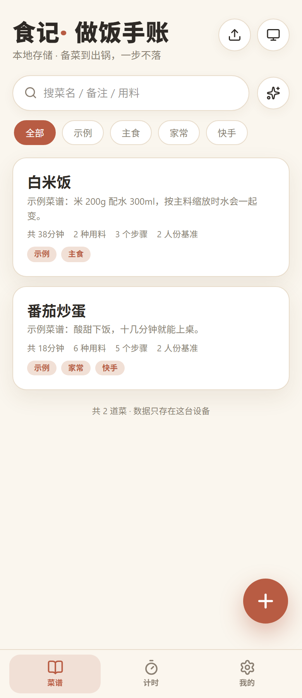
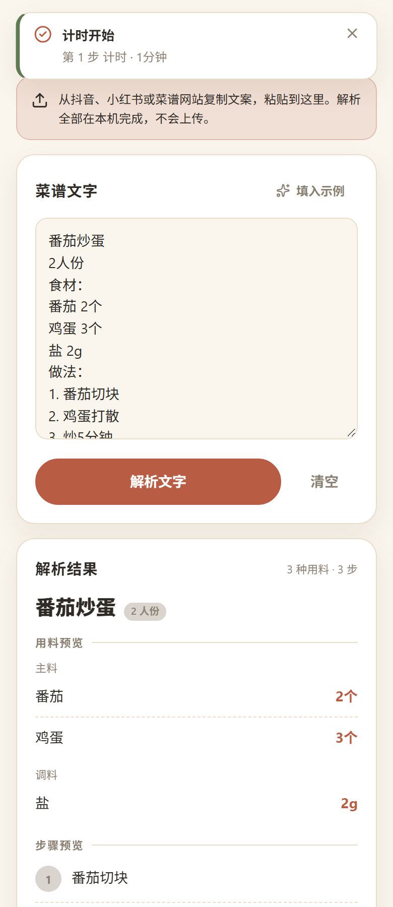
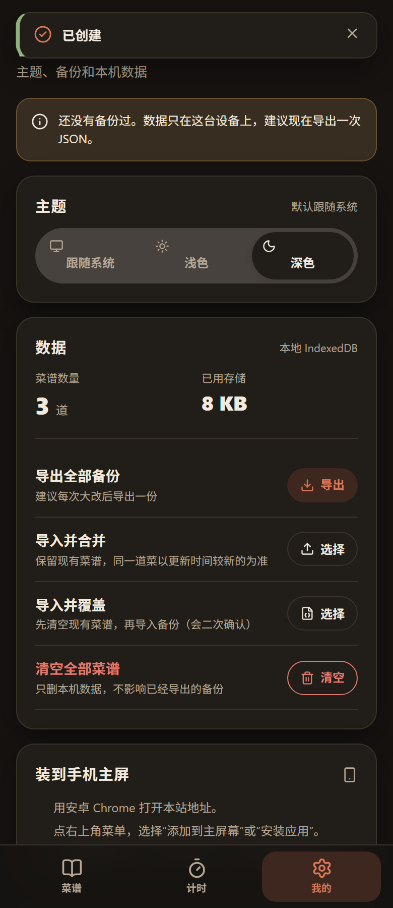

# 找饭吃

本地优先的做饭手账：记录菜谱、备菜和烹饪步骤，按份数或主料自动换算用量，粘贴一段文字就能导入菜谱，做菜时按时间线一步步推进并计时。

所有数据保存在设备本地（IndexedDB），没有账号、没有云端数据库，也不需要联网。

- 网页版（PWA）：<https://shiji-cookbook-i8twnwpp6i3.qoder.zone>
- 安卓安装包：[找饭吃-v1.0.apk](./找饭吃-v1.0.apk)（Android 10+，约 1.3 MB）

## 功能

- 菜谱列表、详情、备菜清单与分步做法
- 按份数等比缩放，也可按主料用量反推其他配料
- 粘贴菜谱文本导入，本机解析、预览后保存
- 做菜时间线：当前步放大显示，手动推进
- 计时器，到点响铃与震动
- 浅色 / 深色主题，默认跟随系统
- JSON 备份导出与导入合并，换设备不丢菜谱
- PWA：可添加到主屏幕，离线打开

## 截图

| 菜谱 | 粘贴导入 | 深色主题 |
| --- | --- | --- |
|  |  |  |

## 安装安卓版

1. 下载 [找饭吃-v1.0.apk](./找饭吃-v1.0.apk)，传到手机。
2. 在手机上打开 APK，按系统提示允许“未知来源 / 外部来源应用”安装。
3. 安装完成后直接打开，无需登录，也无需联网。

安装包使用个人签名，后续升级需要用同一签名文件重新打包才能覆盖安装并保留数据。仓库不包含签名证书；`android-app/keystore.properties` 和对应 `.jks` 需要本地自备（格式见 `android-app/app/build.gradle.kts`）。

## 数据与备份

- 网页版和安卓版的数据各自独立存在本机。
- 在「设置 → 导出全部备份」生成 JSON；安卓版会保存到 `下载/找饭吃/`。
- 在「设置 → 导入并合并」选择 JSON 即可迁移或恢复，重复菜谱会自动跳过。
- 卸载应用或清除应用数据会删除本地菜谱，请保留备份。
- 计时提醒依赖页面内响铃与震动，锁屏或长时间切后台时系统可能延迟，做菜时建议保持应用在前台。

## 本地开发

需要 Node.js `^22.13.0 || >=24.0.0`。

```sh
npm ci
npm run dev
```

生产构建与本地预览：

```sh
npm run build
npm run preview
```

技术栈：React、TypeScript、Vite、Tailwind CSS，静态输出到 `dist/`，无服务端依赖。

`scripts/` 下是基于 Chrome DevTools 协议的端到端与视觉检查脚本；`test/` 下是解析、缩放和计时逻辑的测试。

## 打包安卓版

安卓端是一个 WebView 壳，通过 `WebViewAssetLoader` 加载打包进 `assets/` 的前端静态文件，并提供原生文件导出、导入选择器和确认弹窗。

```sh
npm run build
node scripts/sync-apk-assets.mjs
cd android-app
./gradlew assembleRelease
```

环境：JDK 21、Gradle 8.7、Android SDK（compileSdk / targetSdk 34，minSdk 29）。签名配置从 `android-app/keystore.properties` 读取，缺少该文件时请自行生成密钥并填写。

## 目录结构

```text
src/            前端源码（页面、组件、数据与工具）
public/         PWA manifest、Service Worker、图标
scripts/        图标渲染、资源同步与端到端检查脚本
test/           核心逻辑测试
android-app/    安卓 WebView 壳工程
docs/           README 截图
找饭吃-v1.0.apk 已签名安装包
```
